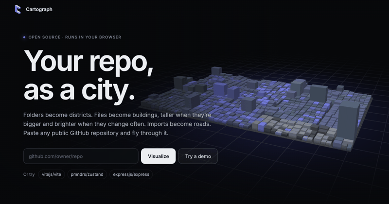

<h1 align="center">Cartograph</h1>

<p align="center"><b>Turn any public GitHub repository into an interactive 3D city.</b><br/>
Folders are districts · files are buildings · height is size · colour is recent change · roads are imports.</p>

<p align="center">
  
  <br/><sub>Placeholder frame. Replace <code>docs/demo.gif</code> with a screen recording (dive into the hero city, long-press a building, switch to Hotspots).</sub>
</p>

<p align="center"><a href="https://coder-4847.github.io/cartograph/">Live demo</a> · <a href="#architecture">Architecture</a> · <a href="#decisions--trade-offs">Decisions</a></p>

---

## Features

- **Landing page with a living hero**: a procedurally generated city orbits behind the headline. Submitting a repo dives the camera into it and the buildings **morph** into the real repository's city.
- **Squarified treemap**: folders nest into districts; single-child folder chains (`src/main/java`) collapse into one district.
- **Thousands of buildings at 60 fps**: one `InstancedBufferGeometry` draw call; position, size, colour per mode and the rise/morph animation are resolved in the vertex shader.
- **Three modes** (segmented control, keys `1` `2` `3`): **Overview**, **Churn heatmap**, **Hotspots** (large *and* frequently changed files pulse).
- **Dependency roads**: animated arcs, drawn only for the hovered or selected building (outgoing and incoming).
- **Gestures that work on mouse and touch**
  - Long-press (600 ms) a building: progress ring, haptic tick, camera flies in, side panel opens with **Open on GitHub**. Long-press a district for the folder.
  - Double-click / double-tap a district: fly-zoom into it.
  - Drag to orbit, scroll or pinch to zoom, right-drag or two-finger drag to pan.
  - Hover or tap lifts a building and shows a tooltip (path, size, last change).
  - `Esc` or swipe the sheet down to close; the camera eases back.
- **⌘/Ctrl + K** search palette, breadcrumb of the current district, minimap (click/drag to move), shortcuts overlay (`?`).
- **Client-side only**: no backend, no AI calls. Everything is cached in `localStorage`; an optional GitHub token (Settings) lifts the rate limit.
- Skeleton loader with a message per stage, friendly error and rate-limit states, responsive layout, `prefers-reduced-motion` respected.

## Quick start

```bash
npm install
npm run dev        # http://localhost:5173
npm test           # layout + parser unit tests (node:test, no extra deps)
npm run build      # type-check + production build into dist/
```

Deep links: `?repo=owner/name` opens a repository straight from the URL, `?demo` opens the bundled sample.

## Controls

| | Mouse | Touch |
|---|---|---|
| Orbit | drag | one finger |
| Zoom | wheel (zooms toward cursor) | pinch |
| Pan | right-drag, arrow keys | two fingers |
| Inspect | hover | tap |
| Open building / folder | hold 0.6 s | hold 0.6 s |
| Fly into district | double-click | double-tap |
| Close panel | `Esc` | swipe the sheet down |
| Search | `⌘/Ctrl K` | |
| Modes | `1` `2` `3` | segmented control |
| Reset camera | `H` | |

## Architecture

```
src/
  api/       GitHub access, no DOM. cache.ts (localStorage + TTL + eviction), github.ts (tree),
             churn.ts (last 30 commits), deps.ts (import parsing + resolution), repo.ts (URL parsing)
  layout/    treemap.ts (squarified treemap -> buildings, districts), scale.ts (size -> height)
  city/      World (renderer/camera/controls), City (facade), Buildings (instanced shader),
             Districts, Roads (arc ribbons), Ground, Labels, BuildingIndex (ray picking),
             Rig (camera flights), Interaction (gestures), palette.ts (colour per mode)
  ui/        Hud, ModeControl, Panel, Search, Tooltip, Breadcrumb, Minimap, Ring, Loader, ...
  landing/   Landing (scroll choreography + dive/morph transition), procedural hero repo, logo
  app.ts     wires data -> city -> UI
  boot.ts    lazy entry: builds the 3D world after first paint
scripts/     make-sample.mjs (bundled dataset), make-logo.mjs (favicon from the animated logo)
tests/       treemap invariants (no overlap, bounds), URL / import parsing and resolution
```

### Data pipeline

1. **Structure**: one `GET /git/trees/HEAD?recursive=1` call returns every path and size.
2. **Churn**: the last 30 commits (`/commits`, then `/commits/{sha}` for file lists, concurrency 6). Each file gets a count and a last-changed time. It is an *approximation* of churn, not blame.
3. **Dependencies**: up to 300 JS/TS/Python files are downloaded from `raw.githubusercontent.com` (concurrency 8) and scanned with regexes; specifiers are resolved against the file tree (extension probing, `index` files, `.js`->`.ts`, `@/` -> `src/`, Python relative/absolute modules).
4. The city appears after steps 1-2; step 3 streams in afterwards (progress pill in the HUD) and roads become available when it finishes.

All three steps are cached in `localStorage` for an hour; quota errors evict the oldest entries.

### Rendering

- **Layout** (`layout/treemap.ts`): each district's weight is `(sqrt(content) + 2 * padding)^2`, so nested padding never starves children. Files weigh `7 + 0.4 * sqrt(size)`. Buildings are sorted in Morton (Z-order) order, which keeps neighbours adjacent in the instance array.
- **Buildings** (`city/buildings.ts`): per-instance attributes hold target and *from* position/size/colour. A single uniform `uT` plays the staggered rise-in (from nothing) **and** the repo-to-repo morph (building `i` -> building `i`; surplus buildings sink). Mode colours are three attributes crossfaded by `uMode`; hotspot pulses are shader-side.
- **Picking** (`city/picking.ts`): a uniform 2D grid + DDA ray walk finds the nearest building without raycasting thousands of instances; the ground hit gives the district.
- **Roads** (`city/roads.ts`): one instanced ribbon mesh; each instance is a quadratic Bézier evaluated in the vertex shader, billboarded to the camera, with a draw-in and flowing dashes in the fragment shader.
- **Camera** (`city/camera.ts`): flights interpolate the target linearly, the orbit radius exponentially and the angles along the short way, on top of `OrbitControls`. A pixel view-offset keeps the focused building clear of the side panel.

## Decisions & trade-offs

Made without asking, as requested:

- **Default branch via `HEAD`**: the tree API accepts `HEAD`, saving a call; `github.com/.../blob/HEAD/...` deep links redirect to the default branch.
- **Height is sub-linear** (`size^0.5`) and scaled by city width, so a 500 KB lockfile doesn't flatten everything else. Footprint grows with `sqrt(size)`, so tiny files stay clickable.
- **Which 300 files get parsed**: JS/TS/Python only, skipping `node_modules`, `dist`, `.d.ts`, minified files and anything over 250 KB; non-test/non-example code first, then largest first.
- **Import resolution is heuristic.** Bare package specifiers (`react`) are ignored, tsconfig `paths` aren't read (only `@/`, `~/`, `#/` -> `src/`), and dynamic imports with expressions are skipped. Good enough to show the shape of a codebase, not a compiler.
- **Rate limits**: unauthenticated GitHub allows 60 requests/hour and one analysis costs ~32. If the limit hits mid-way, churn degrades to partial data with a note instead of failing; if it hits on the tree call you get a clear message, the reset time and a link to Settings. A token (stored only in your browser, sent only to `api.github.com`) raises it to 5,000/hour.
- **Very large repos**: GitHub truncates huge trees; Cartograph keeps the 12,000 largest files and says so in the HUD.
- **Tap vs click**: a tap/click *selects* (tooltip, lift, roads stay); only the long-press (or `Enter`) opens the panel, as specified. Folder long-press targets the ground between buildings, so the panel also links to the parent/containing folder.
- **No bloom pass**: the glow is fog, emissive pulses and a ground light, which keeps it light on mobile GPUs.
- **Sample dataset**: `src/data/sample.json` is generated from a local clone of [vitejs/vite](https://github.com/vitejs/vite) by `npm run sample -- <path>`, using the same parser as the app. The hero city is a seeded, invented repository (`landing/procedural.ts`).
- **Node scripts import the TypeScript sources directly** (Node >= 22.6 type stripping), so source files use plain fields instead of parameter properties.

## Deploy

`.github/workflows/deploy.yml` builds and publishes to GitHub Pages on every push to `main`:

1. Repo **Settings -> Pages -> Source: GitHub Actions**.
2. Push to `main`. The workflow sets `VITE_BASE=/<repo-name>/` (Vite `base`) and `VITE_SITE_URL` (absolute `og:image`/canonical URLs).

Locally `VITE_BASE` defaults to `/`; to test a Pages build: `VITE_BASE=/cartograph/ npm run build && npm run preview`.

## Limitations

- Public repositories only. Churn covers the last 30 commits, so quiet repos show little colour.
- Renaming/moving files shows as the new path only; deleted files aren't drawn.
- Roads reflect the 300 files that were parsed.

## License

MIT
